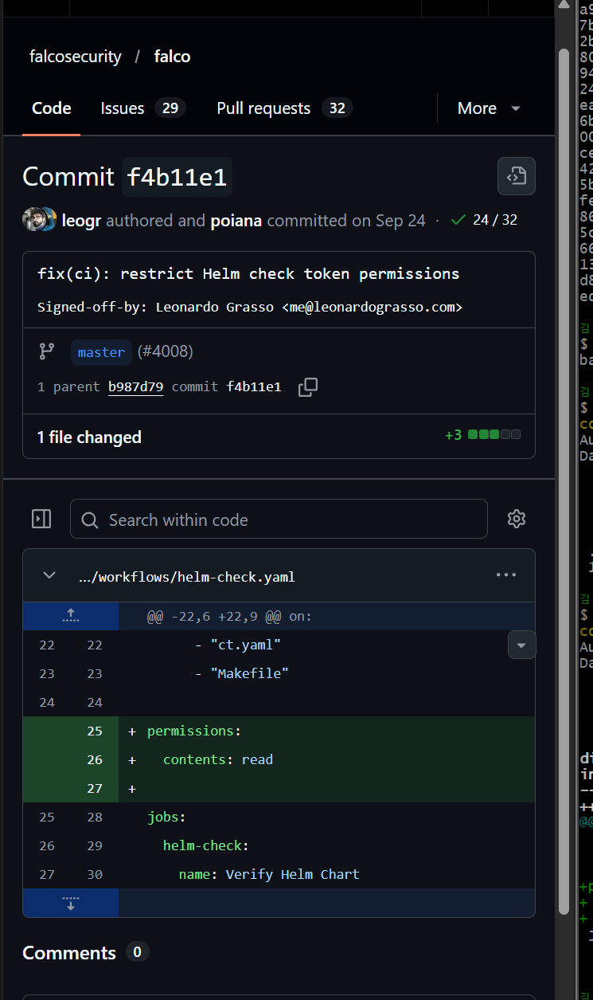
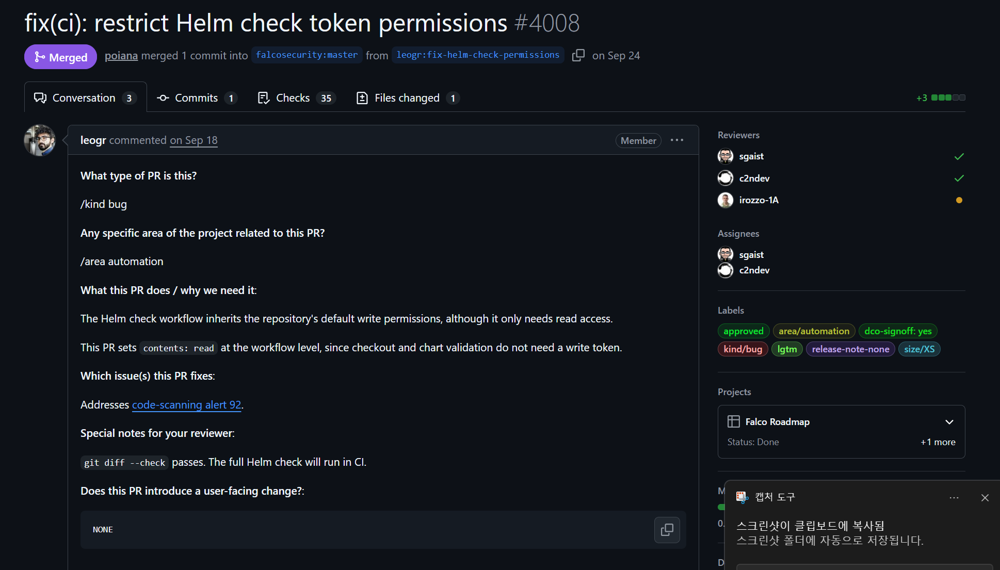
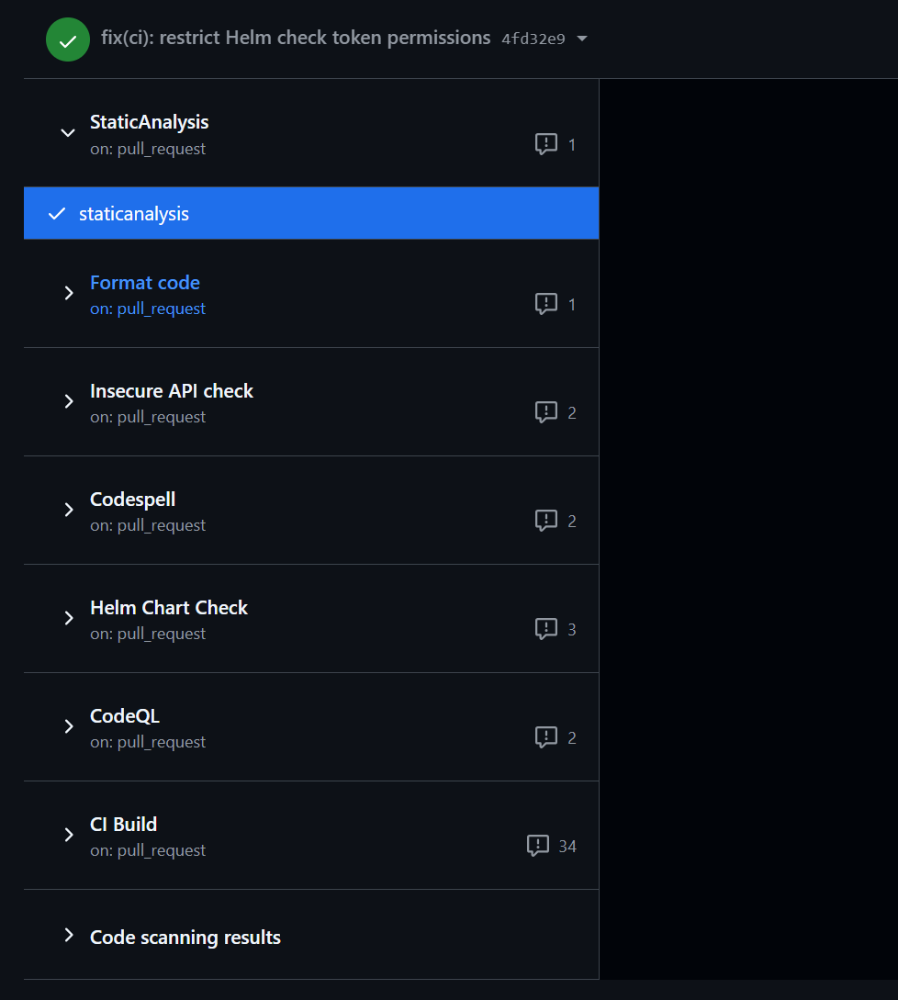
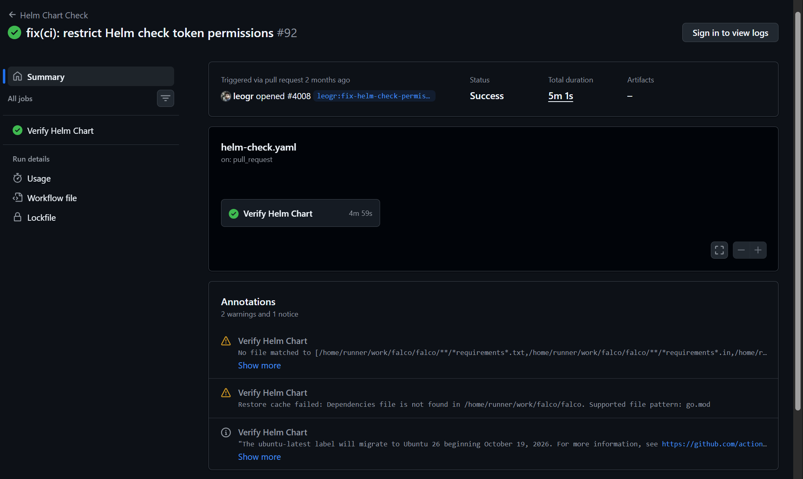

# [Falco] 커밋 분석 - f4b11e1c

**주제:** GitHub Actions Helm 검사 워크플로의 토큰 권한 제한을 통한 CI/CD 보안 강화

---

## 🧩 개요

- **프로젝트명:** Falco
- **커밋 해시:** `f4b11e1cee21b2ae882b90191d3692c4d86cf9b9`
- **커밋 메시지:** `fix(ci): restrict Helm check token permissions`
- **작성자:** Leonardo Grasso
- **커밋 작성일:** 2026-09-18
- **변경 파일:** `.github/workflows/helm-check.yaml`
- **변경 규모:** 1개 파일, 3줄 추가
- **관련 PR:** [#4008](https://github.com/falcosecurity/falco/pull/4008)
- **PR 병합일:** 2026-09-24
- **관련 보안 경고:** Code scanning alert #92
- **릴리즈 노트:** `release-note-none` 라벨 확인

---

## 🔍 변경 요약

### 1. 변경 배경

이번 커밋은 Falco 프로젝트의 GitHub Actions에서 Helm Chart를 검사하는 워크플로의 토큰 권한을 제한하기 위해 진행되었다.

GitHub Actions는 코드 빌드, 테스트 및 배포 등의 작업을 자동화하는 CI/CD 도구이다. 이 과정에서 사용되는 `GITHUB_TOKEN`은 저장소에 접근하거나 특정 작업을 수행할 수 있는 권한을 가진다.

기존 Helm 검사 워크플로는 저장소의 기본 토큰 권한을 상속받고 있었다. PR #4008의 설명에 따르면, 해당 저장소에서는 기본적으로 쓰기 권한이 부여되고 있었지만 Helm 검사 작업에는 읽기 권한만 필요했다.

따라서 실제 작업에 필요하지 않은 권한이 부여되는 문제를 해결하기 위해 수정이 이루어졌다.

### 2. 실제 코드 변경

`git show` 명령어를 사용하여 커밋의 변경 내용을 확인하였다.

**변경 전**

```yaml
jobs:
  helm-check:
    name: Verify Helm Chart
```

**변경 후**

```yaml
permissions:
  contents: read

jobs:
  helm-check:
    name: Verify Helm Chart
```



**Diff 결과**

```diff
+permissions:
+  contents: read
+
 jobs:
   helm-check:
```

기존 워크플로에는 토큰 권한을 명시적으로 제한하는 설정이 없었으나, 변경 후에는 `permissions` 항목이 추가되었다.

`contents: read`는 저장소 콘텐츠에 대한 읽기 권한만 부여하는 설정이다. 워크플로 수준에서 해당 권한을 명시하면 별도로 지정하지 않은 다른 `GITHUB_TOKEN` 권한은 부여되지 않는다.

이를 통해 Helm Chart 검증에 필요하지 않은 쓰기 권한을 제거하고, 최소 권한 원칙을 적용하였다.

---

## 🔐 보안 관점 분석

| 항목 | 이전 버전 | 변경 버전 | 보안적 의미 |
|---|---|---|---|
| 토큰 권한 | 저장소 기본 쓰기 권한 상속 | `contents: read` 명시 | 최소 권한 원칙 적용 |
| 저장소 접근 | 필요 이상의 쓰기 권한 부여 | 콘텐츠 읽기 권한만 허용 | 불필요한 수정 권한 제거 |
| 기타 토큰 권한 | 기본 설정에 의존 | 명시되지 않은 권한은 없음 | 토큰 악용 가능 범위 축소 |
| Helm Chart 검사 | 기존 권한으로 실행 | 제한된 권한으로 실행 | 보안 강화와 검사 기능 유지 |
| CI/CD 보안 | 과도한 권한이 부여될 가능성 | 필요한 권한만 명시 | 자동화 환경의 보안 위험 감소 |

### 1. 최소 권한 원칙 적용

최소 권한 원칙(Principle of Least Privilege)은 사용자나 프로그램에 작업 수행에 필요한 최소한의 권한만 부여하는 보안 원칙이다.

이번 커밋에서는 Helm 검사에 읽기 권한만 필요하다는 점을 고려하여 불필요한 쓰기 권한을 제한하였다.

### 2. 토큰 악용 위험 감소

GitHub Actions에서 사용하는 토큰에 과도한 권한이 부여되면, 토큰이 탈취되거나 워크플로가 악용되었을 때 저장소에 대한 무단 변경 등의 피해가 발생할 수 있다.

이번 변경은 토큰에 부여되는 권한을 제한함으로써 이러한 위험을 줄이는 데 목적이 있다.

다만 토큰 권한 제한만으로 모든 CI/CD 보안 위협을 방지할 수 있는 것은 아니다.

### 3. CI/CD 보안 강화

이번 수정은 Falco의 런타임 탐지 기능 자체를 변경하는 것이 아니라, 개발 및 검증 과정에서 사용되는 자동화 환경의 보안을 강화하는 작업이다.

코드 변경 규모는 3줄로 작지만, 자동화 작업에 불필요한 권한이 부여되는 문제를 개선했다는 점에서 의미가 있다.

---

## 🧾 검증 및 확인

### 1. 관련 PR 및 Issue 확인

- [x] 관련 PR 확인
- [x] 변경 배경 확인
- [x] 관련 보안 경고 확인

**관련 PR:** [Falco #4008](https://github.com/falcosecurity/falco/pull/4008)

PR 설명을 확인한 결과, Helm 검사 워크플로가 실제로는 읽기 권한만 필요하지만 저장소의 기본 쓰기 권한을 상속받고 있다는 문제가 제기되었다.

개발자는 이를 해결하기 위해 워크플로 수준에 `contents: read` 설정을 추가하였다.

또한 PR에서는 해당 수정이 Code scanning alert #92를 해결하기 위한 것이라고 명시하였다.

PR은 2026년 9월 24일 `master` 브랜치에 병합되었다.



### 2. CI/CD 테스트 검증

- [x] GitHub Actions 검사 결과 확인
- [x] Helm Chart Check 성공 확인
- [ ] 로컬 환경에서 별도 테스트 수행



**검증 결과**

| 항목 | 결과 |
|---|---|
| 워크플로 | Helm Chart Check |
| 실행 조건 | pull_request |
| 검증 작업 | Verify Helm Chart |
| 실행 상태 | Success |
| 전체 실행 시간 | 5분 1초 |
| 검증 작업 시간 | 4분 59초 |
| 경고 | 2건 |
| 안내 | 1건 |

GitHub Actions의 Checks 탭에서 Helm Chart Check가 성공적으로 완료된 것을 확인하였다.

이를 통해 변경된 토큰 권한 설정이 해당 CI 검증 작업의 정상적인 수행을 방해하지 않았음을 확인할 수 있었다.

다만 검사 과정에서 의존성 캐시 관련 경고가 발생하였다.

첫 번째 경고는 지정된 requirements 파일 패턴과 일치하는 파일을 찾지 못했다는 내용이며, 두 번째 경고는 `go.mod` 파일을 찾지 못해 캐시 복원에 실패했다는 내용이었다.

이러한 경고가 있었지만 최종 검증 상태는 Success로 표시되었다.

따라서 이번 패치는 CI 작업의 정상적인 실행을 유지하면서 토큰 권한을 제한한 사례로 볼 수 있다.

**CI 실행 결과:** https://github.com/falcosecurity/falco/actions/runs/35333051777


### 3. 릴리즈 노트 확인

- [x] 공식 Releases 페이지 확인
- [x] PR의 릴리즈 노트 관련 라벨 확인

Falco 공식 GitHub Releases 페이지에서 최신 릴리즈 노트를 확인하였으나, Helm 검사 토큰 권한 제한에 대한 직접적인 언급은 발견하지 못하였다.

또한 PR #4008에는 `release-note-none` 라벨이 부여되어 있었다.

이는 해당 변경이 별도의 릴리즈 노트 작성 대상에서 제외된 것으로 해석할 수 있다.

이번 커밋은 사용자 기능을 변경하기보다 CI/CD 환경의 보안 설정을 수정하는 작업이므로, 사용자 대상 기능 변경과 구분된다.

다만 모든 릴리즈 노트에서 해당 변경이 누락되었는지는 확인하지 않았다.

### 4. CVE 및 보안 공지 확인

- [x] GitHub Security Advisories 확인
- [x] NVD에서 Falco 키워드 검색
- [ ] 분석 커밋과 연결된 CVE 확인

Falco 공식 GitHub의 Security Advisories 페이지에서는 탐지 규칙 우회, 커널 모듈 충돌, 의존성 다운로드 문제 등 여러 보안 공지를 확인하였다.

그러나 이번 Helm 검사 토큰 권한 제한 커밋과 직접적으로 연결된 보안 공지는 확인하지 못하였다.

NVD에서 `Falco` 키워드를 검색한 결과, CrowdStrike Falcon 및 WordPress 관련 제품 등 이름이 유사한 다른 소프트웨어의 CVE도 검색되었다.

따라서 검색 결과에 Falco라는 단어가 포함되었다는 이유만으로 해당 CVE가 이번 프로젝트와 관련되어 있다고 판단할 수는 없다.

현재 확인한 자료에서는 분석 대상 커밋에 직접 연결되는 CVE 번호가 발견되지 않았다.

이번 변경은 특정 CVE를 해결한 것으로 확인된 패치라기보다, Code scanning alert #92에서 지적된 권한 설정 문제를 개선한 보안 강화 작업으로 판단된다.

---

## 🔎 관련 사례 및 추가 분석

### 1. GitHub Actions의 토큰 권한 관리

GitHub Actions에서는 `permissions` 설정을 통해 자동화 작업에 부여되는 `GITHUB_TOKEN` 권한을 제한할 수 있다.

예를 들어 저장소 콘텐츠를 읽기만 하는 작업에는 `contents: read`를 설정하여 불필요한 쓰기 권한을 제거할 수 있다.

이는 GitHub에서 권장하는 최소 권한 관리 방식과 일치한다.

### 2. 이번 사례에서 확인한 점

이번 분석을 통해 보안 패치가 반드시 복잡한 코드 수정이나 대규모 기능 변경을 의미하는 것은 아니라는 점을 확인하였다.

Falco의 해당 커밋은 단 3줄의 설정 추가만으로 자동화 작업에 부여되는 권한을 명확하게 제한하였다.

또한 실제 CI 검사 결과를 확인하여 권한 제한 이후에도 Helm Chart 검증 작업이 정상적으로 완료되었음을 확인하였다.

이는 보안 설정을 강화할 때 기존 기능의 정상적인 동작 여부도 함께 검증해야 한다는 점을 보여준다.

---

## 💬 결론

- [x] **업데이트 성격:** 보안 강화
- [x] **CI/CD 신뢰성 영향:** 있음
- [x] **최소 권한 원칙 적용 확인**
- [x] **관련 PR 및 CI 테스트 확인**
- [x] **공식 보안 공지 및 CVE 검색 수행**
- [ ] **추가 확인 필요사항:** Code scanning alert #92의 상세 탐지 규칙, 로컬 환경에서의 재현 검증

이번 커밋은 Falco의 Helm 검사 워크플로에서 불필요하게 부여되던 쓰기 권한을 제한하기 위한 보안 개선 작업이다.

기존에는 저장소의 기본 쓰기 권한을 상속받았지만, 수정 후에는 `contents: read` 설정을 통해 필요한 읽기 권한만 명시적으로 부여하도록 변경되었다.

이를 통해 최소 권한 원칙을 적용하고, GitHub Actions 토큰이 악용되었을 때 발생할 수 있는 피해 범위를 줄이고자 하였다.

또한 GitHub Actions의 Helm Chart Check가 성공적으로 완료된 것을 확인하여, 권한 제한 이후에도 기존 검증 작업이 정상적으로 수행되었음을 확인하였다.

이번 분석을 통해 보안 개선은 단순히 취약점이 발생한 이후 이를 수정하는 것뿐만 아니라, 불필요한 권한을 사전에 제거하여 잠재적인 위험을 줄이는 과정도 포함한다는 점을 알 수 있었다.

---

## 📚 참고

- **Falco 공식 GitHub:** https://github.com/falcosecurity/falco
- **분석 커밋:** https://github.com/falcosecurity/falco/commit/f4b11e1cee21b2ae882b90191d3692c4d86cf9b9
- **관련 PR #4008:** https://github.com/falcosecurity/falco/pull/4008
- **CI 검증 결과:** https://github.com/falcosecurity/falco/actions/runs/35333051777
- **Falco Releases:** https://github.com/falcosecurity/falco/releases
- **Falco Security Advisories:** https://github.com/falcosecurity/falco/security/advisories
- **NVD:** https://nvd.nist.gov/vuln/search
- **GitHub Actions 토큰 권한 관리:** https://docs.github.com/en/actions/security-for-github-actions/security-guides/automatic-token-authentication